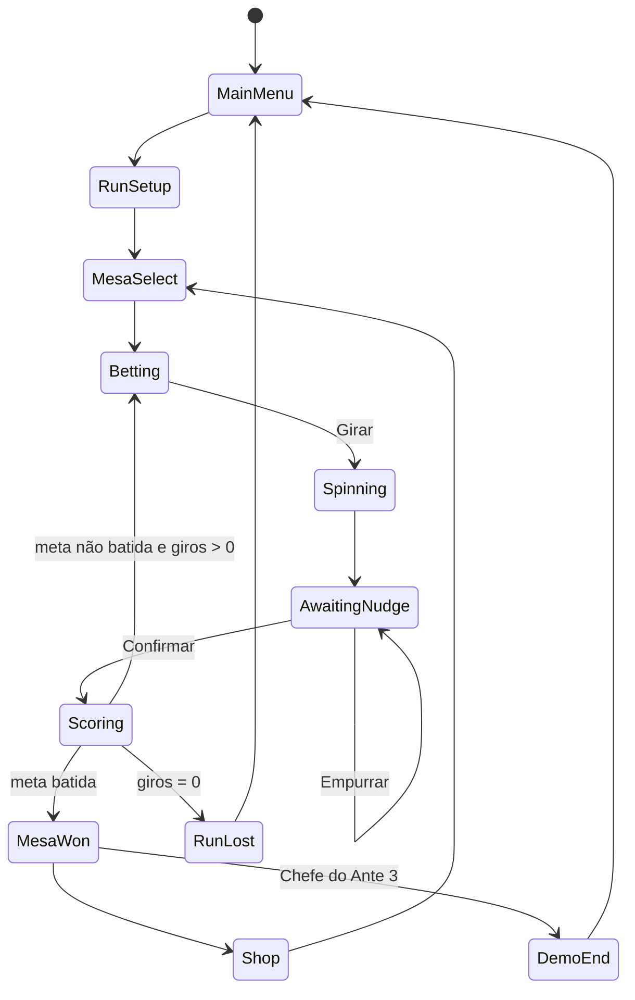

# PLENO — Game Design Document (v0.3 — horror de mesa retrô + retenção)

> **Título provisório:** PLENO (nome da aposta num número só, a de maior risco da roleta)
> **Gênero:** roguelike deckbuilder, com a roda de roleta no lugar do baralho
> **Plataforma:** PC (Steam), Windows/macOS. Controle: mouse (gamepad fica para a 1.0)
> **Engine:** Unity 6 LTS, URP, C#
> **Visual:** horror de mesa em primeira pessoa, 3D low-poly com render retrô de baixa resolução, estética "PS1 / VHS", inspirada no clima de Buckshot Roulette (ver seção 11)
> **Escopo desta versão:** demo vertical slice, pensada para página na Steam, wishlists e Next Fest
> **Status:** rascunho para validar o loop. Todos os números são iniciais e serão calibrados com o simulador (seção 12)

---

## 1. Visão em uma frase

Aposte, gire, empurre a bola e **reconstrua a própria roleta** casa por casa até a matemática quebrar a seu favor.

### 1.1 Pilares de design

1. **Você não controla a sorte, controla as chances.** A graça está em modificar a roda: clonar números, criar casas magnéticas, apagar casas. O jogador sente que "viciou" a roleta.
2. **Toda rodada tem decisão.** Onde apostar, quanto concentrar, quando empurrar a bola e o que comprar. Se o jogador só clica em "girar", o design falhou.
3. **O giro é o clímax.** A bola desacelerando é o momento de tensão, e som, câmera e animação existem para servir a esse momento.
4. **Combos explosivos e legíveis.** O jogador sempre entende de onde veio cada ponto, porque a pontuação é mostrada passo a passo.
5. **Tensão de quem está devendo à Casa.** Ambiente opressivo, luz fraca e um crupiê do outro lado da mesa que observa. O medo vem da atmosfera e do som, nunca de gore gratuito.
6. **"Só mais uma run" (fator Vampire Survivors).** Runs curtas, poder que cresce até o absurdo, algo sempre perto de ser desbloqueado e reinício em um clique. **A luz é o poder:** a run começa no escuro e com medo, e termina com o jogador "quebrando a Casa", com o cômodo inteiro aceso. Detalhes na seção 17.

### 1.1.1 Ambientação (mínima, contada pelo ambiente)

Você acorda sentado a uma mesa de roleta num porão úmido, sob uma única lâmpada. Do outro lado, **o Crupiê**, uma figura sem rosto visível, empurra as fichas na sua direção. Não há explicação: há uma **dívida** e a Casa quer receber.

- Cada **Ante** é um "andar" mais fundo do lugar, com cenário, luz e crupiê diferentes.
- **Perder a run** significa que a Casa cobra: fade para preto, som seco, tela de derrota. Nada explícito.
- **Vencer a demo** leva a uma porta que se abre para um corredor escuro, e aí o jogo corta para "Fim da demo". É o gancho para a 1.0.
- Não há diálogos longos. O Crupiê se comunica por gestos, batidas na mesa e bilhetes escritos à mão deslizados sobre o pano, que são **o próprio tutorial**.

### 1.2 O que NÃO somos

- **Não é jogo de azar.** Não há dinheiro real, microtransação nem loot box. O "$" é moeda interna da run. Isso importa para a classificação indicativa e para as regras da Steam.
- **Não é clone visual.** A mecânica de "fichas × multiplicador" é um padrão de gênero. Arte, nomes, interface e identidade precisam ser próprios. Não usamos fonte, paleta, shader de fundo nem layout que remetam diretamente ao Balatro.
- **Não é cópia do Buckshot Roulette.** Pegamos o **clima** (render retrô, primeira pessoa numa mesa, adversário perturbador, silêncio tenso), que é um estilo compartilhado por vários jogos indie de horror. **Não** copiamos o design do Dealer, o cenário da boate ou banheiro, os itens, a escopeta nem o desfibrilador, nem elementos de interface. Nosso crupiê, nossos cenários e nossos objetos são originais.

---

## 2. Loop principal

```
RUN
 └─ ANTE (3 na demo, 8 na 1.0)
     ├─ Mesa Pequena  ─┐
     ├─ Mesa Grande   ─┼─ cada mesa: bater a META de pontos em até 4 GIROS
     └─ Mesa do Chefe ─┘   (o Chefe tem uma regra que atrapalha)
         └─ após cada mesa vencida → LOJA
```

### 2.1 Uma mesa, passo a passo

1. **Apostar:** o jogador distribui suas **Fichas** (5 por giro) no pano de apostas.
2. **Girar:** a roda e a bola animam. O resultado já foi sorteado antes, pelas casas e seus pesos (ver 10.4).
3. **Empurrar (opcional):** com a bola parada, o jogador pode gastar um **Empurrão** para movê-la uma casa para a esquerda ou para a direita **na ordem física da roda**.
4. **Pontuar:** as apostas vencedoras pontuam e o total do giro soma à mesa.
5. Se a pontuação acumulada chega à **Meta**, a mesa é vencida na hora: **Recompensa**, depois **Loja**.
6. Se os giros acabam sem atingir a Meta, **a run termina**.

### 2.2 Recursos por mesa (valores base)

| Recurso | Valor | Observação |
|---|---|---|
| Giros | 4 | Giro não usado rende +$1 ao vencer a mesa |
| Fichas por giro | 5 | Ficha não usada é perdida (não acumula) |
| Empurrões por mesa | 2 | Movem a bola 1 casa na ordem da roda |

> **Por que o Empurrão é central:** ele transforma "sorte pura" em "sorte + leitura da roda". Na roda europeia o 17 fica entre o 25 e o 34, então quem aposta no 25 e no 34 "cobre" o 17 com um empurrão. Isso cria maestria: o jogador aprende a ordem da roda como aprende o baralho.

---

## 3. Pontuação

### 3.1 Fórmula

```
PONTOS_GIRO = (Σ Pontos) × (Mult)
```

Todas as apostas vencedoras do mesmo giro somam **num único cálculo**, como uma mão de cartas. É daí que vem o combo: acertar Vermelho, Dúzia e Pleno no mesmo número vale muito mais do que três acertos separados.

### 3.2 Ordem de resolução (determinística)

1. **Apostas vencedoras**, na ordem em que foram colocadas:
   `Pontos += PontosBase(tipo, nível) × fichas_na_aposta` e `Mult += MultBase(tipo, nível)`
2. **Casa sorteada:**
   - `Pontos += valor do número` (o 17 soma 17). O **0** soma **36**.
   - Aprimoramento da casa (ver 5.2)
   - Edição da casa (ver 5.3)
3. **Amuletos**, da esquerda para a direita, cada um com sua regra (`+Pontos`, `+Mult`, `×Mult`, `$`).
4. **Resultado:** `Pontos × Mult`, arredondado para baixo, somado ao total da mesa.
5. **Pós-giro:** efeitos de dinheiro, quebra de Vidro e atualização de amuletos que escalam.

**Regra do Zero:** quando cai 0 (ou 00), **todas as apostas externas perdem** (chances simples, dúzias e colunas), como na roleta real. As apostas internas que incluem o zero pontuam normalmente.

**Giro sem vitória:** marca 0 pontos. Alguns amuletos ativam justamente nisso (ver Martingale).

### 3.3 Tipos de aposta e valores base

Valores para a roda europeia (37 casas). A probabilidade é calculada sobre a roda padrão e muda quando o jogador modifica a roda.

| Aposta | Casas cobertas | Prob. | Pontos | Mult | +Pontos/nível | +Mult/nível |
|---|---|---|---|---|---|---|
| Chance simples (Vermelho/Preto, Par/Ímpar, Baixo/Alto) | 18 | 48,6% | 5 | 1 | +10 | +1 |
| Dúzia / Coluna | 12 | 32,4% | 10 | 1 | +15 | +1 |
| Linha (6 números) | 6 | 16,2% | 15 | 2 | +15 | +1 |
| **Vizinhos** (número + 2 de cada lado na roda) | 5 | 13,5% | 20 | 2 | +20 | +2 |
| Quadra | 4 | 10,8% | 20 | 2 | +20 | +2 |
| Rua | 3 | 8,1% | 25 | 3 | +20 | +2 |
| Cavalo | 2 | 5,4% | 30 | 3 | +25 | +2 |
| Pleno | 1 | 2,7% | 50 | 5 | +30 | +3 |

- **Fichas empilhadas** multiplicam os **Pontos** da aposta, não o Mult. Concentrar dá pontos brutos, espalhar dá combo de Mult.
- **Vizinhos** é uma aposta nova, que não existe no pano tradicional. É feita pela **pista** (racetrack), clicando num número. Ela reforça o pilar "aprender a ordem da roda".
- **Nível:** começa em 1 e sobe com as **Tábuas** (ver 6.1).

### 3.4 Exemplo

Apostas: 2 fichas no Vermelho, 2 na 2ª Dúzia e 1 no Pleno 19. Cai o **19** (vermelho, 2ª dúzia).

| Passo | Pontos | Mult |
|---|---|---|
| Vermelho (5 × 2 fichas) | 10 | 1 |
| 2ª Dúzia (10 × 2 fichas) | 30 | 2 |
| Pleno 19 (50 × 1) | 80 | 7 |
| Número 19 | 99 | 7 |
| Amuleto "Teorema" (primo: +10 Mult) | 99 | 17 |
| **Total** | **99 × 17 = 1.683** | |

---

## 4. Estrutura da run

### 4.1 Metas (valores iniciais)

| Ante | Mesa Pequena | Mesa Grande | Mesa do Chefe | Recompensa ($) |
|---|---|---|---|---|
| 1 | 100 | 150 | 200 | 3 / 4 / 5 |
| 2 | 300 | 450 | 600 | 3 / 4 / 5 |
| 3 | 800 → **1.000** | 1.200 → **1.550** | 1.600 → **2.100** | 3 / 4 / 5 |
| 4–8 (1.0) | curva ×2,5 por ante, a calibrar | | | |

> **Calibração do M2 (2026-09-22).** Os valores em negrito do Ante 3 vêm do simulador
> (800 runs por bot, resultados em `Docs/Calibration/`). Com os números originais o Bot Guloso
> vencia 74% das runs, acima da faixa de 55–70% da seção 12. Subir **apenas o Ante 3** corrige
> isso sem tocar na entrada do jogo: um multiplicador global derrubava o Ante 1 para 89%,
> abaixo da meta de 95%. Depois do ajuste: Aleatório 1,8%, Guloso 63,9%, Guloso no Ante 1 97% —
> as três metas da seção 12 atingidas.

A demo termina ao vencer o **Chefe do Ante 3**. Aparece a tela "Fim da demo" com o botão de Wishlist.

### 4.2 Economia

- **$ inicial:** 4
- **Recompensa por mesa:** 3, 4 ou 5, mais $1 por giro não usado
- **Juros:** +$1 para cada $5 guardados, com teto de +$5 por mesa
- **Venda:** o item vende pela metade do preço, arredondado para baixo (mínimo $1)

### 4.3 Pular mesa (fica para a 1.0)

Na 1.0, as Mesas Pequena e Grande poderão ser puladas em troca de uma **Etiqueta** (bônus pontual). A demo não tem isso, para manter o escopo pequeno.

---

## 5. A Roda (o "baralho")

### 5.1 Modelo de dados de uma casa

```
Casa {
  numero: int (0–36; 00 = -1 na roda americana)
  cor: Vermelho | Preto | Verde
  aprimoramento: Nenhum | Dourada | Vidro | Aço | Bônus | Mult | Magnética | Sortuda
  edicao: Nenhuma | Polida | Holográfica | Policromática
  peso: float (base 1.0, define a chance de a bola cair ali)
}
Roda = lista ORDENADA de casas (a ordem física importa: vizinhos e empurrão)
```

- A roda pode **ganhar** casas (clonar) e **perder** casas (apagar), com mínimo de 18.
- **Números repetidos são permitidos:** três casas "17" deixam o Pleno 17 três vezes mais provável.
- As apostas usam o **número e a cor** da casa, não a posição. Se o jogador pinta o 17 de preto, ele passa a contar para "Preto".
- A malha 3D da roda é **gerada proceduralmente** a partir da lista (N setores), e por isso aguenta qualquer tamanho.

### 5.2 Aprimoramentos

| Aprimoramento | Efeito quando a bola cai nela |
|---|---|
| Dourada | +$3 |
| Vidro | ×2 Mult. Chance de 1 em 4 de quebrar: vira uma **Casa Rachada** (a bola que cair nela salta para uma vizinha aleatória) |
| Aço | ×1,5 Mult se a bola cair **nela ou numa casa vizinha** |
| Bônus | +30 Pontos |
| Mult | +4 Mult |
| Magnética | peso ×2 (mais provável). Sem efeito de pontuação |
| Sortuda | 1 em 5: +20 Mult. 1 em 15: +$20 |

### 5.3 Edições

| Edição | Efeito |
|---|---|
| Polida | +50 Pontos |
| Holográfica | +10 Mult |
| Policromática | ×1,5 Mult |

### 5.4 Rodas iniciais (equivalem aos baralhos)

| Roda | Casas | Regra |
|---|---|---|
| **Europeia** | 37 (0–36) | Padrão |
| **Americana** | 38 (0, 00) | +1 Empurrão por mesa. O 00 também faz as apostas externas perderem |
| **Dourada** | 37 | Começa com 3 casas Douradas aleatórias, mas tem −1 Ficha por giro |

Na 1.0 entram ideias como a Roda Francesa ("La Partage", que devolve metade dos pontos no zero) e a Roda Mínima (18 casas, metas +50%).

---

## 6. Consumíveis

O jogador tem **2 espaços** de consumível. Eles podem ser usados a qualquer momento fora do giro.

### 6.1 Tábuas (sobem o nível de uma aposta)

São 8 no total, uma para cada tipo de aposta: Tábua da Chance, da Dúzia/Coluna, da Linha, dos Vizinhos, da Quadra, da Rua, do Cavalo e do Pleno. Cada uma sobe o tipo em +1 nível (tabela 3.3). Preço: $3.

### 6.2 Cartas da Casa (modificam a roda)

Preço: $3. Ao usar uma carta, a roda aparece em close e o jogador escolhe as casas afetadas.

| Carta | Efeito |
|---|---|
| O Ourives | 1 casa vira Dourada |
| O Vidraceiro | até 2 casas viram Vidro |
| O Ferreiro | 1 casa vira Aço |
| O Ímã | 1 casa vira Magnética |
| O Trevo | até 2 casas viram Sortuda |
| O Pintor | inverte a cor (Vermelho↔Preto) de até 3 casas |
| O Gêmeo | 1 casa copia o número e a cor de outra casa escolhida |
| O Coveiro | remove até 2 casas da roda (mínimo 18) |
| O Artesão | adiciona 1 casa nova, cópia de uma casa escolhida, ao lado dela |
| O Tesoureiro | dobra o $ atual (máximo +$20) |
| O Oráculo | cria 2 Tábuas aleatórias (se houver espaço) |
| A Fortuna | 1 em 4: adiciona uma edição aleatória a um Amuleto aleatório |

---

## 7. Amuletos (o motor dos combos)

São **5 espaços**, e a ordem da esquerda para a direita importa, porque é a ordem em que os efeitos resolvem. O jogador pode arrastar para reordenar.

Raridades: **Comum** ($4–5), **Incomum** ($6–7), **Raro** ($8–10) e **Lendário** (só aparece em pacote).
Chance de aparecer na loja: Comum 70%, Incomum 25%, Raro 5%.

### 7.1 Lista da demo (40)

**Pontos e Mult diretos**

| # | Nome | Raridade | Efeito |
|---|---|---|---|
| 1 | Ficha Gasta | C | +4 Mult |
| 2 | Rosa Rubra | C | Aposta em Vermelho venceu: +8 Mult |
| 3 | Lua Negra | C | Aposta em Preto venceu: +8 Mult |
| 4 | Par Perfeito | C | Aposta em Par venceu: +40 Pontos |
| 5 | Ímpar Solitário | C | Aposta em Ímpar venceu: +40 Pontos |
| 6 | Dúzia de Padeiro | C | Aposta de Dúzia venceu: +6 Mult |
| 7 | Colunata | C | Aposta de Coluna venceu: +6 Mult |
| 8 | Arranha-céu | C | O valor do número conta em dobro nos Pontos |
| 9 | Cobertura Total | C | +1 Mult por aposta colocada no giro (vencedora ou não) |
| 10 | Teorema | I | Número primo: +10 Mult |
| 11 | Fibonacci | I | Número de Fibonacci (1, 2, 3, 5, 8, 13, 21, 34): ×2 Mult |
| 12 | Mira Laser | I | Pleno venceu: ×3 Mult |
| 13 | Boa Vizinhança | I | Vizinhos venceu: ×1,5 Mult |
| 14 | Combo Triplo | I | 3 ou mais apostas venceram no giro: ×2 Mult |
| 15 | Tudo no Zero | I | Caiu 0 ou 00: ×4 Mult |
| 16 | Pilha Alta | I | Aposta vencedora com 3 ou mais fichas: ×1,5 Mult |

**Condicionais e que escalam**

| # | Nome | Raridade | Efeito |
|---|---|---|---|
| 17 | Martingale | C | +3 Mult acumulado a cada giro sem vitória. Zera ao vencer |
| 18 | Maré Quente | I | ×(1 + 0,25 por giro vencedor consecutivo). Zera ao perder |
| 19 | Número da Sorte | I | Sorteia um número por mesa. Se cair nele: ×5 Mult |
| 20 | Colecionador | I | +1 Mult permanente por número diferente que já caiu na run |
| 21 | Diário do Crupiê | C | +5 Pontos permanentes por giro jogado |
| 22 | Prêmio de Consolação | C | Giro sem vitória pontua (valor do número × 2) × 1 |
| 23 | Ferrugem | I | Casas de Aço dão ×0,25 Mult adicional para cada casa de Aço da roda |
| 24 | Colecionador de Cacos | R | Ganha ×0,5 Mult permanente sempre que uma casa de Vidro quebra |

**Economia**

| # | Nome | Raridade | Efeito |
|---|---|---|---|
| 25 | Cofrinho | C | Giro não usado rende +$2 (em vez de +$1) |
| 26 | Gorjeta | C | +$1 sempre que uma chance simples vence |
| 27 | Juros Compostos | I | O teto de juros sobe para +$10 |
| 28 | Cupom | C | O primeiro reroll de cada loja é grátis |
| 29 | Veia de Ouro | I | Casas Douradas dão +$2 extra |
| 30 | Reciclagem | C | Vender consumível dá +$2 extra |

**Manipulação da roda**

| # | Nome | Raridade | Efeito |
|---|---|---|---|
| 31 | Luva de Seda | C | +1 Empurrão por mesa |
| 32 | Dados Carregados | I | O Empurrão pode mover até 2 casas |
| 33 | Ímã de Neodímio | I | Casas Magnéticas têm peso ×4 (em vez de ×2) |
| 34 | Previsão | I | Uma vez por mesa, antes de apostar, revela a **cor** do próximo resultado |
| 35 | Roda Viciada | R | O número que caiu no giro anterior tem peso ×3 no próximo |
| 36 | Segunda Bola | R | Uma vez por mesa, o giro usa 2 bolas e **as duas pontuam** |

**Fichas e consumíveis**

| # | Nome | Raridade | Efeito |
|---|---|---|---|
| 37 | Bolso Fundo | I | +1 Ficha por giro |
| 38 | Astrólogo | I | Tábuas têm 25% de chance de subir +2 níveis |
| 39 | Cartomante | I | Ao vencer uma mesa, cria 1 Carta da Casa (se houver espaço) |

**Lendário (demo: 1)**

| # | Nome | Raridade | Efeito |
|---|---|---|---|
| 40 | O Crupiê | L | ×0,5 Mult para cada casa aprimorada da roda |

---

## 8. Chefes (Crupiês)

Cada Mesa do Chefe sorteia um Crupiê, sem repetir na mesma run. A regra dele aparece **antes** da mesa, para o jogador se planejar. A demo tem 6.

**Apresentação física:** nas Mesas Pequena e Grande, quem opera a mesa é o **Crupiê padrão**. Na Mesa do Chefe, a luz apaga por um instante e, quando volta, **outro personagem está sentado à sua frente**. Cada chefe tem silhueta própria, um objeto que ele coloca sobre a mesa (e que representa a regra) e um "tique" de animação e som. Exemplos:

| Crupiê | Objeto na mesa | Tique |
|---|---|---|
| O Duplo Zero | Crava uma segunda bolinha verde na roda | Ri sem som, só os ombros se mexem |
| A Névoa | Acende um incenso, e a fumaça cobre a roda | Respiração pesada e lenta |
| O Contador | Ábaco que ele move a cada giro | Estala os dedos a cada ficha colocada |
| Mão Pesada | Apoia a mão enfaixada sobre a borda da roda | Batida seca na mesa se você tenta empurrar |
| O Daltônico | Óculos de lentes cinza sobre o pano | Inclina a cabeça, olhando para você |
| O Relojoeiro | Relógio de bolso aberto, tique-taque alto | Olha o relógio antes de cada giro |

| Crupiê | Regra |
|---|---|
| **O Duplo Zero** | Adiciona uma casa 00 temporária. Ela também faz as apostas externas perderem |
| **A Névoa** | Os números da roda ficam ocultos durante o giro (a pista e o pano continuam visíveis) |
| **O Contador** | Apostas de Pleno não pontuam |
| **Mão Pesada** | Empurrões desativados |
| **O Daltônico** | Apostas em cor não pontuam |
| **O Relojoeiro** | Só 3 giros nesta mesa |

Reservados para a 1.0: A Maré (aprimoramentos desativados), O Imposto (−$1 por aposta colocada), Contramão (a bola gira ao contrário e os Empurrões se invertem), A Aranha (o primeiro giro sempre cai no 0), O Avarento (−1 Ficha por giro) e O Espelho (os amuletos resolvem da direita para a esquerda).

---

## 9. Loja e pacotes

**Apresentação:** a loja não é uma tela separada. O Crupiê coloca sobre a mesa uma **maleta** e a abre na sua direção. Dentro, forrados de veludo gasto, estão os amuletos (objetos físicos), as Cartas da Casa (cartões amarelados), as Tábuas (plaquinhas de madeira gravadas) e os pacotes (envelopes lacrados). O jogador clica no item, o item aproxima da câmera, e aparece a etiqueta de preço. O reroll é uma **campainha** de balcão.

- **2 espaços de Amuleto** e **2 de Consumível** à venda, mais **1 Pacote**
- **Reroll:** $5, e cada reroll seguinte na mesma loja custa +$1

| Pacote | Preço | Conteúdo |
|---|---|---|
| Pacote de Tábuas | $4 | Escolha 1 entre 3 Tábuas |
| Pacote da Casa | $4 | Escolha 1 entre 3 Cartas da Casa (uso imediato na hora) |
| Pacote de Amuletos | $6 | Escolha 1 entre 2 Amuletos (chance de Lendário: 0,5%) |

---

## 10. Especificação técnica

### 10.1 Stack

| Item | Escolha | Motivo |
|---|---|---|
| Engine | Unity 6 LTS, URP | Suporte longo, shaders e pós-processamento |
| UI | Diegética (objetos 3D na mesa) + uGUI/TextMeshPro mínimo com fonte bitmap | A maior parte da informação mora no cenário (ver 11.3) |
| Render retrô | Render Texture em baixa resolução + shaders próprios (ver 11.2) | Estética PS1/VHS controlada |
| Câmera | Cinemachine 3 | Transições suaves entre os pontos de vista da mesa |
| Tween | PrimeTween (grátis) | Rápido, sem alocação de memória |
| Serialização | com.unity.nuget.newtonsoft-json | Para salvar a run |
| Testes | Unity Test Framework (NUnit, EditMode) | Motor de regras 100% testável |
| IA no editor | Unity MCP + Claude Code | Cenas, prefabs, scripts, console |
| Versionamento | Git + Git LFS | Para modelos, texturas e áudio |

### 10.2 Arquitetura: regras separadas da apresentação

**Regra de ouro:** todo o jogo (regras, pontuação, RNG, loja) roda **sem Unity**. A camada visual só **lê o estado** e **toca os eventos**. Isso permite testes automáticos, o simulador de balanceamento e o Claude Code gerando e testando lógica sem depender do Editor.

```
Assets/_Pleno/
├─ Scripts/
│  ├─ Core/                  (asmdef Pleno.Core, noEngineReferences = true)
│  │  ├─ Model/              Casa, Roda, Aposta, RunState, MesaState, Amuleto...
│  │  ├─ Rules/              BetResolver, WheelRng, ScoringPipeline, ShopGenerator
│  │  ├─ Effects/            IRelicEffect, RelicEffectRegistry, efeitos individuais
│  │  ├─ Content/            Definições em código (ids, números base)
│  │  ├─ Events/             ScoreStep, GameEvent (fila de eventos para animar)
│  │  └─ Rng/                SeededRng (PCG32 / xorshift), um stream por sistema
│  ├─ Data/                  (asmdef Pleno.Data) ScriptableObjects: nomes, ícones, textos
│  ├─ Game/                  (asmdef Pleno.Game) GameStateMachine, controllers, Save/Load
│  ├─ Presentation/          (asmdef Pleno.Presentation)
│  │  ├─ Wheel/              WheelMeshBuilder, WheelView, BallAnimator
│  │  ├─ Table/              BettingTableView, RacetrackView, ChipView
│  │  ├─ Scoring/            ScorePlaybackController (toca os ScoreSteps)
│  │  ├─ Shop/  UI/  Fx/  Audio/
│  └─ Sim/                   (asmdef Pleno.Sim, Editor) simulador Monte Carlo
├─ Tests/EditMode/           (asmdef Pleno.Tests) testes do Core
├─ Art/  Audio/  Prefabs/  Scenes/  Settings/
```

### 10.3 Pipeline de pontuação: calcular primeiro, animar depois

O Core calcula o giro inteiro e devolve uma **lista de passos**. A camada visual toca esses passos com ritmo, como no contador da seção 3.4.

```csharp
public enum ScoreStepKind { BetWon, PocketValue, Enhancement, Edition, Relic, Final, Money, GlassBreak }

public readonly struct ScoreStep {
    public readonly ScoreStepKind Kind;
    public readonly string SourceId;   // "bet:pleno:19", "relic:teorema", "pocket:12"
    public readonly double PontosAdd;
    public readonly double MultAdd;
    public readonly double MultX;      // 1.0 = sem efeito
    public readonly int MoneyDelta;
    public readonly double PontosAfter, MultAfter; // snapshot para a UI
}

public sealed class SpinResult {
    public int PocketIndex;            // índice na roda (posição física)
    public IReadOnlyList<ScoreStep> Steps;
    public double Total;               // floor(Pontos × Mult)
}
```

Os valores usam `double`, porque as pontuações ficam enormes no fim do jogo. Acima de 1e11, a UI mostra em notação científica.

### 10.4 RNG e sorteio da casa

- A run tem uma **semente** de 8 caracteres, exibida e compartilhável.
- Cada sistema tem seu **stream separado**, derivado da semente: `wheel`, `shop`, `pack`, `relic`, `boss`, `luck`, `vault`. Assim, comprar algo na loja não muda o próximo giro, e a run é reproduzível.
- **Sorteio:** roleta ponderada sobre `peso` de cada casa, já com os modificadores de amuletos e chefes aplicados.
- **A física é fake:** o resultado é sorteado **antes** e a animação é resolvida para terminar nele (10.6). Nunca usar física real para decidir o resultado.

### 10.5 Efeitos de Amuleto: ganchos

```csharp
public interface IRelicEffect {
    string Id { get; }
    void OnMesaStart(RunState run, MesaState mesa) {}
    void OnBeforeSpin(SpinContext ctx) {}              // Previsão, Número da Sorte
    void ModifyWeights(SpinContext ctx, float[] w) {}  // Ímã, Roda Viciada
    void OnNudge(SpinContext ctx, ref int maxDistance) {}
    void OnScore(SpinContext ctx, ScoreAccumulator acc) {} // o principal
    void OnAfterSpin(SpinContext ctx) {}                // escaladores, dinheiro
    void OnMesaEnd(RunState run, MesaState mesa, bool won) {}
    void OnShopEnter(ShopState shop) {}
}
```

- Registro por atributo: `[RelicEffect("teorema")] public sealed class Teorema : RelicEffectBase { ... }`
- **Estado persistente** de amuletos que escalam (Martingale, Colecionador) fica em `RelicInstance.Counters` (um dicionário `string → double`), que é serializável.
- Chefes usam a mesma interface (`IBossRule`), com ganchos extras: `ModifyTableRules` e `ModifyMesaResources`.

### 10.6 Roda 3D e animação da bola

- **WheelMeshBuilder:** gera N setores (cone raso) a partir de `Roda`. A cor de cada casa sai de uma `MaterialPropertyBlock`, e os números de um atlas de textura ou TMP em world space. Precisa regenerar ao clonar ou remover casas, com uma animação da roda "se reorganizando".
- **BallAnimator** (paramétrico, sem física):
  1. A roda gira com velocidade angular ω₀, que decai (ease-out).
  2. A bola orbita no sentido contrário, no raio externo, e desacelera.
  3. Em `t_drop`, o raio cai até o anel das casas, com 2 ou 3 "quiques" (ruído com seed) nos defletores.
  4. O ângulo final é **resolvido** para que a bola termine exatamente no centro de `PocketIndex`: `rotaçãoTotal = k·360° + offsetAlvo`.
- **Duração:** cerca de 3,5 s, com as opções x2, x4 e "pular".
- **Empurrão:** a bola faz um pequeno arco até a casa vizinha, com o som de um "tec".
- **Câmera:** primeira pessoa, sentado à mesa (ver 11.4). Durante o giro, a câmera se inclina devagar sobre a roda. Nos últimos 0,8 s, um zoom leve, a lâmpada oscila e o som ambiente abafa: só o chocalho da bola fica audível.

### 10.7 Máquina de estados



### 10.8 Save

- Salva automaticamente ao entrar em `MesaSelect`, `Shop` e `Betting` (início de cada giro).
- Formato: JSON do `RunState` completo, incluindo o estado de cada stream de RNG. Assim, "sair e voltar" não permite trocar o resultado.
- `profile.json` separado guarda estatísticas e desbloqueios (na demo, só as estatísticas).

---

## 11. Arte, UI e áudio

### 11.1 Direção de arte: "horror de mesa retrô"

**Referência de clima:** Buckshot Roulette e o horror indie em estilo PS1, ou seja, 3D de baixa resolução, texturas pequenas e borradas, escuridão quase total e uma única fonte de luz forte. A mesa é uma ilha de luz num lugar que você não consegue ver direito.

**Regras visuais:**

- **Luz é o design.** Cada cena tem 1 luz principal (lâmpada pendurada, luminária de mesa) e o resto em sombra profunda. A mesa e a roda são sempre os pontos mais iluminados.
- **Paleta restrita por andar.** Tons dessaturados e sujos, e **uma única cor de destaque** por Ante:
  - Ante 1, Porão: amarelo sódio e verde-pano
  - Ante 2, Sala de Máquinas: âmbar e ferrugem
  - Ante 3, Salão Vazio: vermelho profundo e dourado gasto
- **Cores da roda** (vermelho, preto e verde) sempre com contraste alto e **ícones auxiliares** nas casas (losango no vermelho, círculo no preto) para daltonismo e baixa resolução.
- **Materiais com história:** pano da mesa manchado e puído, fichas lascadas, madeira riscada, metal oxidado. Nada novo ou limpo.
- **Modelos:** low-poly (roda com 300–800 tris, objetos com 100–500), texturas de 64 a 256 px, filtro *point* (sem suavização).
- **Personagens:** rostos sempre na sombra ou cobertos (máscara, capuz, contraluz). A expressão vem das mãos, da postura e do som. Isso barateia a produção e aumenta o desconforto.

### 11.2 Pipeline de render retrô (URP)

Executado como *Renderer Features* e shaders próprios, **com opção de ajuste nas configurações**:

| Etapa | Técnica | Parâmetro inicial |
|---|---|---|
| Resolução interna baixa | A câmera renderiza numa Render Texture pequena, que é ampliada com filtro *point* | 480×270 (opções: 320×180 / 480×270 / 640×360) |
| Vertex snapping | O shader arredonda a posição dos vértices em clip space (o "tremor" do PS1) | grade de 160×90, sutil |
| Texturas afins (opcional) | Deformação sem correção de perspectiva, só em objetos de fundo | desligado na mesa (atrapalha a leitura) |
| Dithering | Bayer 4×4 aplicado antes da quantização de cor | intensidade de 0,6 |
| Quantização de cor | Limita a paleta (15 a 24 bits efetivos) ou mapeia para uma LUT por andar | LUT por Ante |
| Névoa | Distance fog escura que "come" o fundo do cenário | começa a 3 m, preta a 8 m |
| Grão e VHS | Ruído animado, leve aberração cromática, scanline fraca e vinheta | grão 0,15 e vinheta 0,4 |
| Flicker | A intensidade da lâmpada oscila com curva de ruído, e em eventos "falha" por 2 ou 3 frames | ligado a eventos (11.5) |

**Camada de leitura nítida:** números de pontuação, preços e textos de efeito ficam numa **segunda câmera/overlay em resolução nativa**, com **fonte bitmap pixelada** (renderizada em escala inteira). O mundo é retrô, mas a informação é sempre legível.

**Acessibilidade:** opções para desligar grão, flicker, aberração e vertex snapping, e um aviso de fotossensibilidade na primeira abertura.

### 11.3 UI diegética: a informação mora na mesa

| Informação | Onde aparece |
|---|---|
| Fichas por giro | Pilha física de fichas à sua direita. Você as arrasta ou clica para colocar no pano |
| Giros restantes | Bolinhas de marfim num pote de vidro ao lado da roda. O Crupiê tira uma a cada giro |
| Empurrões | Marcas de giz na borda da mesa. Uma é apagada a cada uso |
| $ | Maço de notas velhas preso por um clipe, com o valor escrito num papel |
| Meta e pontuação da mesa | **Placar mecânico** de palhetas (flip-flap) na parede atrás do Crupiê, com um "clack" a cada virada |
| Pontos × Mult do giro | Dois **visores de tubo Nixie** embutidos na borda da mesa, que brilham laranja |
| Amuletos | Objetos físicos alinhados numa prateleira de feltro à sua esquerda, na ordem de resolução. Ao ativar, o objeto **pula e brilha** |
| Consumíveis | Dois cartões presos sob o cinzeiro, à sua direita |
| Regra do chefe | O objeto que ele coloca na mesa + um bilhete escrito à mão |
| Tooltips | Etiquetas de papel pendendo de um barbante, com texto na camada nítida |

**Pontuação passo a passo:** cada ScoreStep (10.3) faz o objeto de origem reagir (a ficha na aposta vencedora pula, a casa da roda acende, o amuleto treme). Os Nixies atualizam com um som elétrico curto e, no resultado final, o placar da parede vira com um estrondo de palhetas. Se a pontuação estourar a meta, a lâmpada pisca forte uma vez.

### 11.4 Câmera e posições de vista

Primeira pessoa, sentado. A câmera tem **pontos de vista fixos**, com transição via Cinemachine e um leve balanço de "respiração":

| Vista | Uso | Como acessar |
|---|---|---|
| **Mesa** (padrão) | Apostar: pano e roda à frente, Crupiê ao fundo | padrão / W |
| **Roda** (close) | Durante o giro, o empurrão e o uso de Cartas da Casa | automática ao girar / S |
| **Prateleira** | Reordenar e inspecionar amuletos | A |
| **Maleta** | Loja | automática após vencer a mesa |
| **Parede** | Olhar o placar e o bilhete do chefe | levantar o mouse |

O mouse move levemente a cabeça (±8°) em todas as vistas. É um detalhe que dá presença sem atrapalhar os cliques.

### 11.5 Momentos de tensão (roteiro de "juice" sombrio; a escalada de poder está em 17.2)

- **Antes de girar:** o Crupiê estende a mão, espera 1 segundo parado e só então solta a bola.
- **Giro acontecendo:** o ambiente abafa. Os últimos quiques da bola têm um leve slow-motion (0,85×).
- **Giro sem vitória:** o Crupiê puxa as fichas perdidas com um rodo de madeira, devagar.
- **Última chance** (último giro e a meta ainda longe): a lâmpada começa a falhar, um zumbido grave sobe e o Crupiê se inclina para a frente.
- **Vitória na mesa:** silêncio, a lâmpada estabiliza e o Crupiê empurra a maleta.
- **Derrota:** a luz apaga de uma vez. Um único som seco, e a tela de estatísticas aparece escrita num papel sob a luz de um isqueiro.

### 11.6 Cenários da demo

| Ante | Cenário | Elementos originais |
|---|---|---|
| 1 | **Porão** | Paredes de tijolo úmidas, cano pingando (som de ritmo), caixas de bebida vazias |
| 2 | **Sala de Máquinas** | Caldeira ao fundo que ronca a cada giro, correntes penduradas, manômetros |
| 3 | **Salão Vazio** | Um cassino antigo abandonado, cadeiras viradas, lustre apagado. Só a sua mesa tem luz |

### 11.7 Áudio (metade do clima)

- **Sem música contínua.** O som é **ambiente em camadas** (zumbido elétrico, pingos, rangidos, respiração distante) e um drone grave que sobe com o Mult do giro.
- O **chocalho da bola** continua sendo o som mais importante: loop com pitch e volume ligados à velocidade, com muito detalhe de foley e o eco do cômodo.
- **Foley pesado e seco:** fichas de argila, madeira, papel, metal. Cada objeto tem 3 a 5 variações de som.
- **Pontuação:** os Nixies fazem um "tic" elétrico que sobe de tom a cada passo, e o placar mecânico faz um "clack" em cascata.
- **Crupiês:** nunca falam. Cada um tem uma assinatura sonora (risada abafada, tique-taque, respiração).
- **Mixagem:** a reverb muda por cenário, e os sons ficam abafados quando a câmera vai para a vista da roda.

---

## 12. Balanceamento: simulador Monte Carlo

Assembly `Pleno.Sim`: uma janela do Editor (e modo headless via `-batchmode -executeMethod`) que roda **10.000+ runs** com bots:

| Bot | Estratégia |
|---|---|
| Aleatório | Fichas em apostas aleatórias, compra aleatória |
| Cobertura | Espalha fichas em apostas externas |
| Sniper | Concentra em Plenos e Vizinhos |
| Guloso | Maximiza o valor esperado do giro com o estado atual (inclui Empurrão ótimo) |

**Métricas geradas (CSV):** taxa de vitória por ante, pontuação média e p90 por mesa, taxa de compra e de vitória por amuleto, $ médio na loja.

**Metas de calibração para a demo:**

- **Bot Guloso** vence o Ante 1 em pelo menos 95% das runs e a demo inteira em 55–70%.
- **Bot Aleatório** vence a demo inteira em menos de 5%.
- **Nenhum amuleto sozinho** aparece em mais de 60% das runs vencedoras (senão é forte demais).

**Resultados do M2 (800 runs por bot, com o Ante 3 calibrado):**

| Bot | Vitória | Ante 1 | Ante 2 | Ante 3 |
|---|---|---|---|---|
| Aleatório | 1,8% | 21% | 8% | 2% |
| Cobertura | 73,1% | 91% | 84% | 73% |
| Sniper | **0,0%** | 4% | 0% | 0% |
| Guloso | 63,9% | 97% | 92% | 64% |

**Duas descobertas que o simulador entregou:**

1. **O Sniper é inviável.** Concentrar em Plenos e Vizinhos vence 0% das runs e só 4% dos Antes 1.
   A fantasia do atirador é central no design (Mira Laser, Boa Vizinhança, a própria aposta que dá
   nome ao jogo), então ou os valores de Pleno/Vizinhos da seção 3.3 sobem, ou o arquétipo só
   funciona apoiado nos 30 amuletos que ainda faltam. **Rever depois do M4.**
2. **Valor esperado não é o mesmo que vencer.** A primeira versão do Bot Guloso maximizava o valor
   esperado do giro e perdia para o Bot Cobertura (41% contra 76%), apesar de tirar giros 3× maiores.
   Numa mesa de 4 giros, consistência bate pico. O bot passou a maximizar `E[min(pontos, falta)]`.
   Isso é um sinal de design, não só de bot: **o jogo hoje premia cobertura, não ousadia.**

**Limite desta calibração:** só 10 dos 40 amuletos existem. As builds disponíveis são artificialmente
fracas, então as metas tendem a ficar **fáceis demais** quando os outros 30 entrarem. Recalibrar no M4.

---

## 13. Escopo da demo (checklist)

- [ ] 1 roda jogável (Europeia) + 2 desbloqueadas desde o início (Americana, Dourada)
- [ ] 8 tipos de aposta com pano e pista
- [ ] 3 antes (9 mesas), 6 chefes
- [ ] 40 amuletos, 12 Cartas da Casa, 8 Tábuas, 3 pacotes
- [ ] Loja com reroll, venda e reordenação de amuletos
- [ ] Empurrão
- [ ] Save e continuar
- [ ] Retenção (seção 17): Cofre do Chefe, 6 evoluções, escalada de luz (4 estágios), Balcão com 6 melhorias permanentes, 15 amuletos desbloqueáveis por desafio, Coleção, tela de derrota com "quase" + progresso, reinício em 1 clique
- [ ] Tutorial contextual nas 2 primeiras mesas, feito com os bilhetes do Crupiê
- [ ] Opções: volume, velocidade do giro, tela cheia/resolução, resolução retrô, grão/flicker/vertex snapping on/off, idioma PT-BR/EN
- [ ] Cenários dos 3 Antes, Crupiê padrão e 6 Crupiês-chefe (silhueta, objeto, tique)
- [ ] Tela de fim da demo com Wishlist
- [ ] Simulador e testes do Core passando no CI

**Fora da demo:** meta-progressão completa (a demo tem a versão reduzida da seção 17.5), pular mesa com Etiquetas, níveis de dificuldade, modo sem fim, runs diárias com seed, conquistas Steam, gamepad, Steam Deck.

---

## 14. Roadmap (dev solo com IA, estimativa grosseira)

| Marco | Entrega | Duração |
|---|---|---|
| **M0 — Setup** | Projeto Unity 6 URP, Git LFS, asmdefs, Unity MCP + Claude Code, CLAUDE.md | 2–3 dias |
| **M1 — Core** | Modelo, RNG, BetResolver, ScoringPipeline, 10 amuletos, testes | 1–2 semanas |
| **M2 — Simulador** | Bots + CSV, primeira calibração das metas | 1 semana |
| **M3 — Greybox jogável** | Roda 2D simples, pano, giro, empurrão, loja em caixas cinza. **Teste de diversão aqui** | 2 semanas |
| **M4 — Conteúdo e retenção** | 40 amuletos, evoluções, cartas, tábuas, chefes, pacotes, Cofre, Balcão, desafios, Coleção | 2–3 semanas |
| **M5 — Roda 3D, cenário e atmosfera** | Malha procedural, animação da bola, pipeline retrô (11.2), cenário do Ante 1, Crupiê padrão, UI diegética, playback de pontuação | 3–4 semanas |
| **M6 — Áudio, UI final, tutorial, opções** | | 2 semanas |
| **M7 — Steam** | Página, cápsulas, trailer, build da demo, playtests | 2 semanas |

> **Gate do M3:** se o greybox não for divertido com cubos cinza, arte não vai salvar o jogo. Faça 5 playtests com amigos antes de seguir para o M4. A pergunta que valida é: "você quis jogar mais uma run?"

---

## 15. Riscos e perguntas em aberto

| Risco | Mitigação |
|---|---|
| Sensação de "caça-níquel" (pouca agência) | Empurrão, modificação da roda, Previsão, highlight de probabilidade. Medir no playtest |
| Números altos e repetidos na roda quebram o jogo (roda com 20 casas "17") | Mínimo de 18 casas, custo crescente de O Gêmeo e O Artesão, chefes que punem repetição (1.0) |
| Percepção de "jogo de azar" (classificação, Steam) | Sem dinheiro real e sem monetização aleatória. Comunicar "estratégia" no marketing |
| Comparação direta com o Balatro | Identidade visual própria, a roda como baralho e o Empurrão como diferenciais claros no trailer |
| Escopo do dev solo | Core sem Unity + simulador = a IA consegue produzir e testar sozinha a maior parte da lógica |
| Baixa resolução prejudica a leitura de números e apostas | Texto de jogo em camada nítida por cima do render retrô (11.2). Highlight forte das casas cobertas. Opção de "resolução retrô" (baixa/média/alta) |
| Horror afasta parte do público de roguelike | Tensão sem gore e sem jumpscare. Divulgar como "roguelike de roleta com atmosfera sombria", não como jogo de terror |
| Comparação com o Buckshot Roulette | Crupiês, cenários e objetos originais. O loop é outro (construção da roda e combos), e o trailer deve mostrar isso nos primeiros 5 segundos |
| Personagens 3D animados custam caro para um dev solo | Crupiês com poucas animações e silhuetas fortes, rostos sempre na sombra, e a expressividade vinda de mãos, objetos, luz e som |

**Perguntas para decidir depois do playtest:**

1. O Empurrão deve ser por mesa ou uma moeda comprável na loja?
2. Fichas não usadas deveriam valer algo (+Pontos ou $)?
3. A Casa Rachada (Vidro quebrado) é divertida ou só frustrante?
4. Faz sentido limitar o empilhamento de fichas por aposta?

---

## 16. Prompt inicial para o Claude Code (M0 + M1)

Cole no Claude Code, na raiz do projeto Unity, com este GDD salvo em `Docs/GDD_PLENO.md`:

```
Leia Docs/GDD_PLENO.md inteiro antes de começar. Vamos implementar os marcos M0 e M1.

M0:
1. Crie a estrutura de pastas da seção 10.2 em Assets/_Pleno/.
2. Crie os asmdefs: Pleno.Core (noEngineReferences: true), Pleno.Data, Pleno.Game,
   Pleno.Presentation, Pleno.Sim (Editor only) e Pleno.Tests (EditMode, referencia Core).
3. Configure .gitignore e .gitattributes (Git LFS para fbx, png, psd, wav, ogg).
4. Crie um CLAUDE.md na raiz com: regras de arquitetura (Core sem UnityEngine, todo o RNG
   via SeededRng, nada de física decidindo resultado), convenções de nome (código em inglês,
   textos de UI em PT-BR via tabela de localização), e o comando para rodar os testes em
   batchmode.

M1 (tudo em Pleno.Core, com testes NUnit para cada item):
1. SeededRng (PCG32) com streams nomeados derivados da seed da run.
2. Modelo: Pocket, Wheel (lista ordenada, vizinhos circulares, add/remove/clone), BetType
   (os 8 tipos da seção 3.3), PlacedBet, RunState, MesaState, RelicInstance.
3. Layout da roda europeia e da americana na ordem física real.
4. BetResolver: dado um Pocket, quais PlacedBets vencem (incluindo a regra do zero para as
   apostas externas e Vizinhos pela ordem da roda).
5. WheelRng: sorteio ponderado por peso.
6. ScoringPipeline seguindo a ordem da seção 3.2, retornando SpinResult com a lista de ScoreSteps.
7. IRelicEffect + RelicEffectRegistry via atributo, e implemente os amuletos 1, 2, 8, 10, 12,
   14, 17, 20, 31 e 33 da seção 7.1.
8. Teste de regressão que reproduz exatamente o exemplo da seção 3.4 (resultado 1.683).

Não crie nada visual ainda. Ao final, rode os testes e me mostre o resumo.
```

---

## 17. Retenção: o fator "só mais uma run"

### 17.1 O que torna Vampire Survivors viciante, e como traduzimos

| Mecanismo do VS | Por que funciona | Tradução no PLENO |
|---|---|---|
| Começa fraco, termina com a tela explodindo | Fantasia de poder crescente e visível | **Escalada de luz** (17.2): o cômodo escuro vai se acendendo até a Casa "quebrar" |
| Evoluções (arma + passivo) | Descoberta, objetivo de build, "aha!" | **Evoluções de amuleto** (17.3) |
| Abrir o baú | Pico de dopamina com antecipação | **Cofre do Chefe** (17.4) |
| Ouro sempre, mesmo perdendo | Nenhuma run é desperdiçada | **Moedas da Casa** e o **Balcão** (17.5) |
| Desbloqueios por desafio e coleção com "???" | Sempre há um próximo objetivo | Desafios e **Coleção** (17.5) |
| Sessão curta, input mínimo | Cabe em qualquer intervalo | Run da demo em 12–18 min, reinício em 1 clique (17.6) |
| Preço baixo | Compra por impulso e boca a boca | Sugestão: US$ 4,99–7,99 na 1.0 |

### 17.2 Curva de poder: "a luz é o poder"

A run tem um arco emocional deliberado: **medo → controle → absurdo**.

| Estágio | Gatilho (no giro) | O que acontece no cenário |
|---|---|---|
| 0 — Escuro | padrão | Uma lâmpada, sombras, o Crupiê imóvel |
| 1 — Faísca | giro ≥ 1× a meta da mesa | Fichas saltam do pano, a lâmpada estoura de brilho por um instante, o Crupiê recua levemente |
| 2 — Acendendo | giro ≥ 10× a meta | Uma segunda luz acende no cômodo e revela parte do cenário. O placar da parede gira sem parar antes de travar |
| 3 — Incêndio | giro ≥ 100× a meta | A roda brilha incandescente, fichas chovem do teto, a câmera treme, o Crupiê **se levanta** |
| 4 — A Casa quebra | giro ≥ 1.000× a meta | **Todas as luzes do cômodo acendem** e revelam o lugar inteiro pela primeira vez. O Crupiê some. Silêncio de 1 s, depois um estrondo |

- O estágio de luz alcançado **persiste pelo resto da mesa**. O cômodo fica mais claro enquanto o jogador está "dominando".
- A primeira vez que o jogador atinge cada estágio fica registrada na Coleção, e isso vira desafio de desbloqueio.
- Tudo é puramente visual e sonoro. As regras não mudam.

### 17.3 Evoluções de amuleto

Um amuleto **evolui** quando a condição é cumprida e o jogador vence um Chefe: a evolução sai no Cofre. A versão evoluída substitui a base e, quando a receita usa dois amuletos, **libera um espaço**.

| Base | Condição | Evolução | Efeito |
|---|---|---|---|
| Ficha Gasta | ter 3 ou mais casas com aprimoramento Mult | **Ficha de Chumbo** | +4 Mult por casa Mult da roda |
| Martingale | ter Luva de Seda | **Sistema Infalível** | O Mult acumulado não zera ao vencer, só cai pela metade (consome a Luva de Seda) |
| Mira Laser | ter 3 ou mais casas com o mesmo número | **Mira Telescópica** | Pleno venceu: ×6 Mult |
| Teorema | ter Fibonacci | **Sequência Áurea** | Número primo **ou** Fibonacci: ×3 Mult (consome Fibonacci) |
| Ímã de Neodímio | ter 4 ou mais casas Magnéticas | **Buraco Negro** | A casa mais pesada tem peso ×8. Empurrões podem puxar a bola até ela, a qualquer distância, 1× por mesa |
| Segunda Bola | ter Bolso Fundo | **Chuva de Bolas** | Todo giro usa 2 bolas, e 1× por mesa usa 3 (consome Bolso Fundo) |

- **Descoberta:** antes da primeira evolução, a loja mostra apenas um ícone "?" brilhando no amuleto que pode evoluir. Depois de descoberta, a receita fica visível na Coleção.
- A 1.0 terá de 20 a 25 evoluções, e algumas serão segredos, sem pista visível.

### 17.4 Cofre do Chefe

Depois de vencer cada Mesa do Chefe, **antes da loja**, o Crupiê empurra um cofre de ferro trancado sobre a mesa.

1. O jogador clica e a fechadura gira como uma **mini-roleta de combinação**, com o chocalho acelerando.
2. O cofre se abre com um feixe de luz cuja cor indica a quantidade de prêmios: branco = 1, dourado = 3 e vermelho = 5 (chances iniciais: 75% / 22% / 3%).
3. Os prêmios saem **um por um**, com pausa e som crescente.

**Conteúdo, por prioridade:** evolução disponível (sempre vem, se houver), edição aleatória em um amuleto, Tábua do tipo de aposta mais usado, e $ (3 a 8).

O Cofre usa o stream de RNG `vault`, separado dos outros (10.4).

### 17.5 Meta-progressão

**Moedas da Casa:** a moeda permanente, ganha em **toda** run, inclusive nas perdidas.
`moedas = 10 × mesas vencidas + floor(log10(maior giro da run)) × 5 + bônus de estágio de luz`
A tela final mostra essa conta item por item, como um recibo.

**O Balcão (entre runs):** um guichê gradeado no corredor onde o jogador compra melhorias permanentes. Todas podem ser reembolsadas a qualquer momento, sem perda (como no VS).

| Melhoria | Níveis | Efeito por nível | Custo (níveis) |
|---|---|---|---|
| Bolso Inicial | 3 | +$1 inicial | 50 / 100 / 200 |
| Mão Firme | 2 | +1 Empurrão no primeiro giro de cada mesa | 150 / 400 |
| Ficha Extra | 1 | +1 Ficha no primeiro giro de cada mesa | 300 |
| Olho Clínico | 3 | +3% de chance de Raro na loja | 100 / 200 / 400 |
| Freguês | 2 | Reroll −$1 | 120 / 300 |
| Cofre Reforçado | 2 | +5% de chance de Cofre dourado | 200 / 500 |

- **A demo tem essas 6.** A 1.0 amplia a lista e acrescenta **Limites de Mesa** (níveis de dificuldade), que multiplicam as Moedas ganhas.
- **Teto de poder:** o Balcão ajuda, mas não substitui a habilidade. O simulador (seção 12) roda com o Balcão zerado e com ele no máximo, e a meta é que a taxa de vitória do Bot Guloso suba no máximo +15 pontos percentuais.

**Desbloqueios por desafio:** a run começa com **25 dos 40 amuletos** no conjunto de sorteio. Os outros 15 se desbloqueiam com desafios, e **cada desafio ensina uma mecânica**:

| Desafio (exemplos) | Desbloqueia |
|---|---|
| Vencer uma mesa usando só apostas de Pleno | Mira Laser |
| Fazer uma casa de Vidro quebrar 3 vezes numa run | Colecionador de Cacos |
| Ter 3 casas com o mesmo número | Roda Viciada |
| Usar 10 Empurrões numa run | Dados Carregados |
| Alcançar o estágio de luz 2 | Segunda Bola |
| Vencer uma mesa com um giro que caiu no 0 | Tudo no Zero |
| Terminar uma mesa com $25 ou mais | Juros Compostos |
| Vencer o Ante 1 com a Roda Dourada | O Crupiê (lendário) |

**Coleção (o álbum):** uma pasta de couro na mesa do menu. Mostra todos os amuletos, cartas, tábuas, evoluções, crupiês e estágios de luz, e o que ainda não foi descoberto aparece como silhueta "???". O percentual de conclusão fica visível na capa.

**Segredos (1.0):** códigos numéricos apostados em sequência no pano liberam modificadores e easter eggs, que a comunidade descobre e compartilha.

### 17.6 Ritmo de sessão

- **Duração da run:** demo com 12–18 min. A 1.0 terá 25–35 min, com opção de "run curta" de 4 antes.
- **Velocidade:** a primeira run usa 1×. A partir da segunda, o padrão é 2×. Segurar **Espaço** acelera o giro para 4×.
- **Reinício instantâneo:** da tela de derrota até a primeira aposta da nova run em **menos de 3 segundos**, com um único botão: "Mais uma".
- **A tela de derrota trabalha a favor da próxima run.** Ela mostra:
  1. o **"quase"**: "faltaram 214 pontos"
  2. o recibo das Moedas da Casa ganhas
  3. a **barra do próximo desbloqueio**: "Desafio: 7/10 Empurrões"
  4. o melhor giro da run, com o estágio de luz alcançado
- **Nunca uma run sem ganho:** toda run rende Moedas e avanço em algum desafio.

### 17.7 Limites éticos

O objetivo é ser viciante **como jogo**, não como cassino:

- Sem dinheiro real, sem loot box paga, sem moeda premium e sem anúncios.
- Sem recompensa de login diário, sem FOMO e sem punição por ficar dias sem jogar.
- O Cofre e os pacotes usam apenas moeda ganha jogando.
- Isso protege a classificação indicativa e a aprovação na Steam, e é coerente com o tema: a Casa é a vilã, não o modelo de negócio.

---

*Fim do GDD v0.3. Próxima revisão depois do playtest do greybox (M3).*
